# SNES ROM hacks

IPS patches for SNES games that add battery-saved high scores and a trainer menu, and speed some of them up. No ROMs are included: apply each patch to your own clean, unheadered USA ROM with any IPS patcher (Floating IPS, Lunar IPS, or soft-patching in your emulator or flash cart).

| Game | Folder | Original ROM CRC32 | High scores | Trainer | FastROM |
|---|---|---|---|---|---|
| Axelay (USA) | [axelay](axelay) | `F812B533` | New top 10 table + saver | 4 options | Added |
| R-Type III: The Third Lightning (USA) | [rtype3-sa1](rtype3-sa1) | `642B656B` | New top 10 table + saver | 3 options | Added + SA-1 (no slowdown) |
| Wild Guns (USA) | [wild-guns](wild-guns) | `085D8D14` | Saver only (game's own top 5) | 5 options | Added |
| Space Megaforce / Super Aleste (USA) | [super-aleste](super-aleste) | `11202781` | Two new top 10 tables + saver | 5 options | Not needed |
| Pocky & Rocky (USA) | [pocky-rocky](pocky-rocky) | `2B0E7EA3` | New top 10 table + saver | 6 options | Added |
| Pocky & Rocky 2 (USA) | [pocky-rocky-2](pocky-rocky-2) | `FC00BB1B` | New top 10 table + saver, plus game progress save | 5 options | Added |
| Plok (USA) | [plok](plok) | `BBD678F6` | New top 10 table + saver | 4 options | Already in original |

"New top 10 table + saver" means the game gets a high score table it didn't have before, and that table is kept in battery SRAM. "Saver only" means the game's own high score table is left as it was and is now kept in battery SRAM instead of being lost at power off.

## The games

### Axelay

| Title screen | Trainer menu | High score table |
|:-:|:-:|:-:|
| 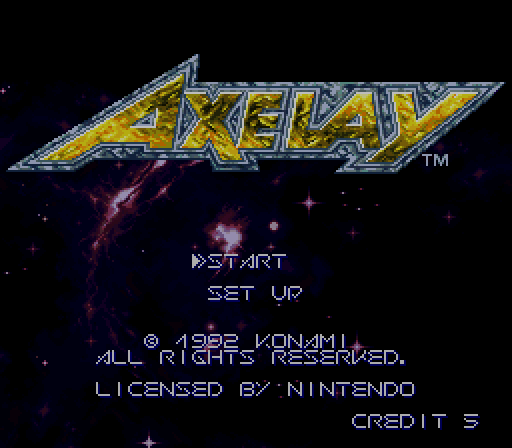 | 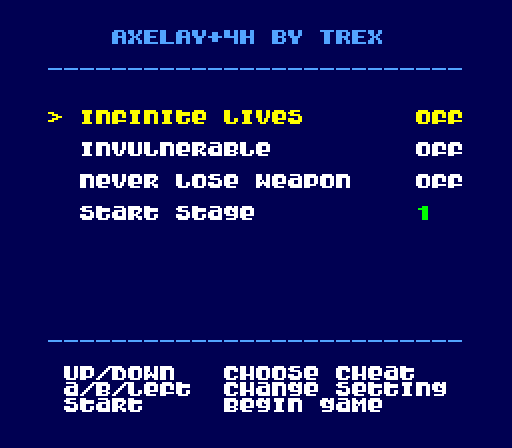 | 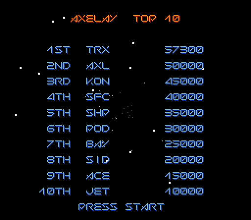 |

- **High scores: both.** The original keeps a single high score that is lost at power off. It now has a top 10 table with initials, saved to battery SRAM, in Axelay's own font over a sprite starfield. The game's own record (57300) is the 1st place default, and the HUD's HI shows the table's top score.
- **Trainer:**
  - INFINITE LIVES: lives never go down.
  - INVULNERABLE: bullets and crashes do no harm.
  - NEVER LOSE WEAPON: a bullet hit doesn't destroy the weapon in use.
  - START STAGE: start on stage 1-6.

### R-Type III: The Third Lightning

| Title screen | Trainer menu | High score table |
|:-:|:-:|:-:|
| 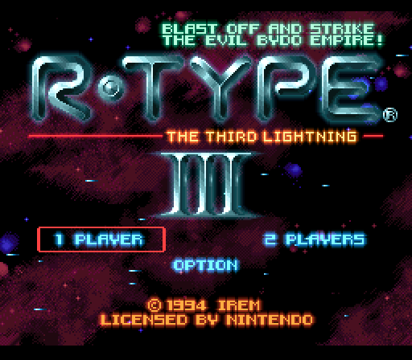 | 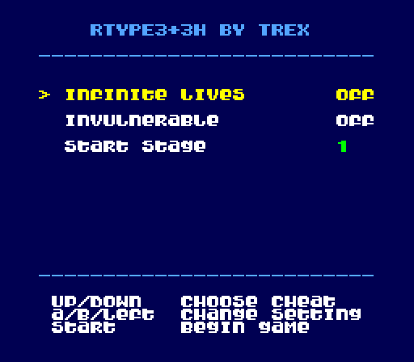 | 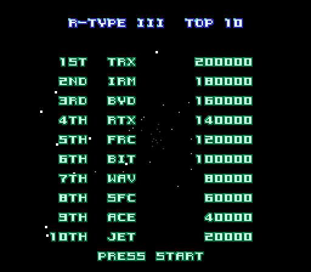 |

- **High scores: both.** The original has no saved table. It now has a top 10 table with initials, saved to battery RAM, in R-Type III's own lettering over a sprite starfield. Only player 1's score goes into the table in 2-player mode.
- **Also:** the game logic runs on the SA-1 chip at 10.74 MHz, which removes almost all of the original's slowdown. Needs an emulator, flash cart or FPGA core with SA-1 support.
- **Trainer:**
  - INFINITE LIVES: lives never go down.
  - INVULNERABLE: the ship can't be hit.
  - START STAGE: start on stage 1-6.

### Wild Guns

| Title screen | Trainer menu | Ranking (now saved) |
|:-:|:-:|:-:|
| 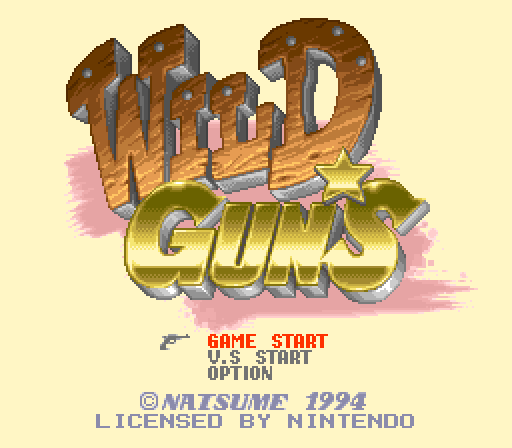 | 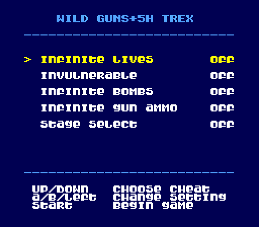 | 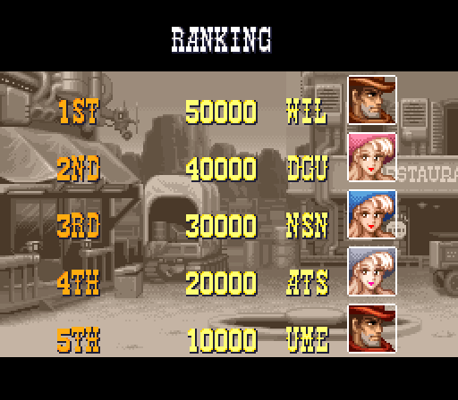 |

- **High scores: saver only.** Wild Guns already has its own top 5 RANKING with initials and character portraits, but the original loses it at power off. The patch keeps that ranking in battery SRAM, and leaves its look, initials entry and attract loop exactly as they were.
- **Trainer:**
  - INFINITE LIVES: lives never go down.
  - INVULNERABLE: shots and knock-downs do no harm.
  - INFINITE BOMBS: bombs never run out.
  - INFINITE GUN AMMO: special guns never run out of shots.
  - STAGE SELECT: turns on the game's hidden stage select for every game.

### Space Megaforce / Super Aleste

| Title screen | Trainer menu | High score table |
|:-:|:-:|:-:|
| 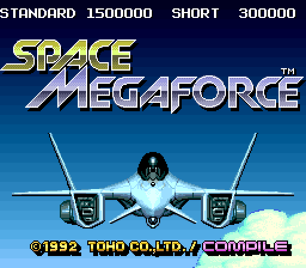 | 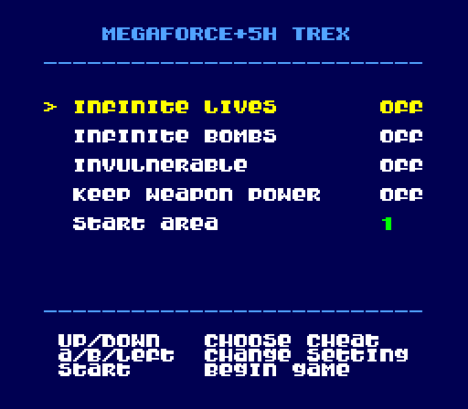 | 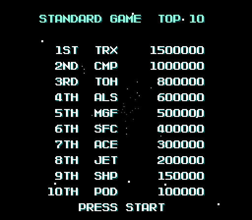 |

- **High scores: both.** The original keeps one record each for the standard and the short game, lost at power off. It now has two top 10 tables with initials, one per mode, saved to battery SRAM. The game's own records (1,500,000 standard, 300,000 short) are the 1st place defaults, and the title screen and HUD show each table's top score.
- **Trainer:**
  - INFINITE LIVES: lives never go down.
  - INFINITE BOMBS: bombs never run out.
  - INVULNERABLE: hits do no harm (being crushed by scenery still kills).
  - KEEP WEAPON POWER: a hit doesn't lower the weapon power level.
  - START AREA: start on area 1-12.

### Pocky & Rocky

| Title screen | Trainer menu | High score table |
|:-:|:-:|:-:|
| 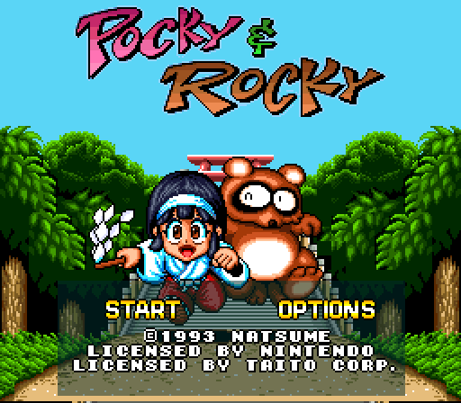 | 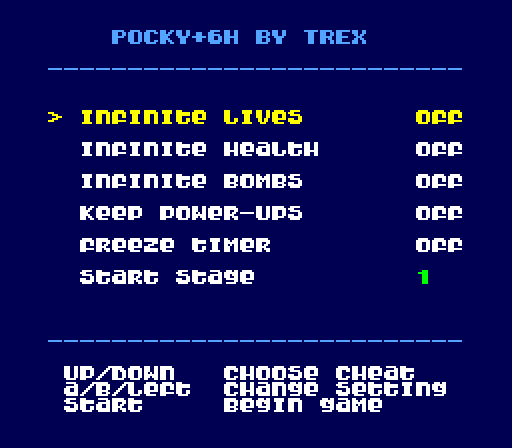 | 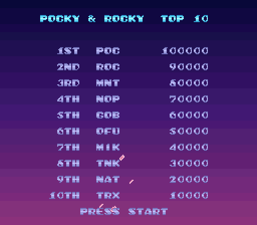 |

- **High scores: both.** The original has no score table at all. It now has a top 10 table with initials, saved to battery SRAM, in the game's own font over a dusk sky with falling cherry blossom. Both players enter initials at game over, each on their own joypad.
- **Trainer:**
  - INFINITE LIVES: lives never go down.
  - INFINITE HEALTH: hits do no damage.
  - INFINITE BOMBS: bombs never run out.
  - KEEP POWER-UPS: a hit doesn't lower the shot power.
  - FREEZE TIMER: the stage timer stops.
  - START STAGE: start on stage 1-6.

### Pocky & Rocky 2

| Title screen | Trainer menu | High score table |
|:-:|:-:|:-:|
| 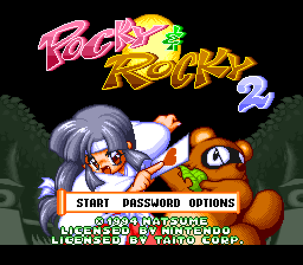 | 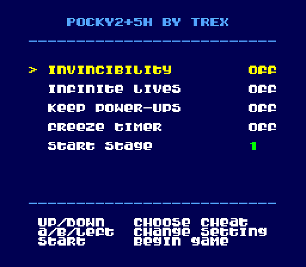 | 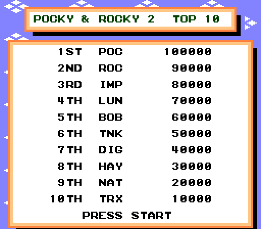 |

- **High scores: both.** The original has no score table at all. It now has a top 10 table with initials, saved to battery SRAM, in the game's own password-screen style.
- **Also:** a battery save of your progress at every stage clear (stage, score, lives, gold and keys). Choose PASSWORD on the title to carry on from it.
- **Trainer:**
  - INVINCIBILITY: hits do no harm (pits and running out of time still cost a life).
  - INFINITE LIVES: lives never go down.
  - KEEP POWER-UPS: a hit doesn't lose power-ups.
  - FREEZE TIMER: the stage timer stops.
  - START STAGE: start on stage 1-9.

### Plok

| Title screen | Trainer menu | High score table |
|:-:|:-:|:-:|
| 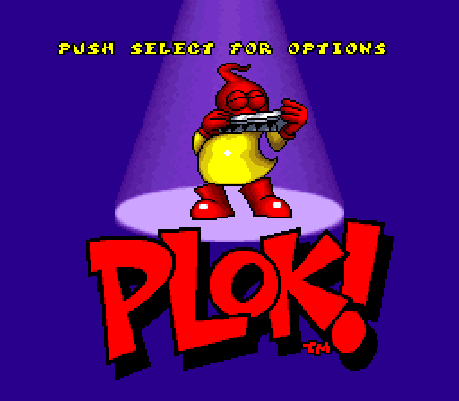 | 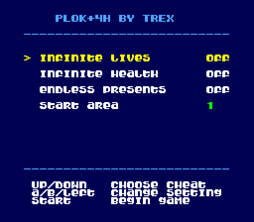 | 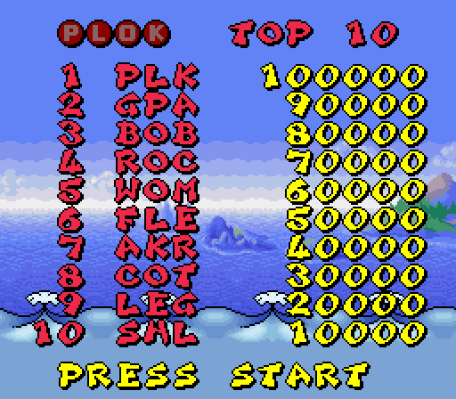 |

- **High scores: both.** Plok keeps a score but has no table. It now has a top 10 table with initials, saved to battery SRAM, in Plok's own font over the Cotton Island sea. The ending now returns to the title so the score can be entered, instead of looping forever.
- **Trainer:**
  - INFINITE LIVES: lives never go down.
  - INFINITE HEALTH: hits do no damage (water and pits still kill).
  - ENDLESS PRESENTS: costumes from presents never time out.
  - START AREA: start in area 1-4 (Cotton Island, second Cotton Island stretch, Legacy Island, Akrillic).

## Common to all of them

- The trainer menu appears at power on. Up/Down picks an option, Left/Right/A/B changes it, START plays.
- High scores are only saved when every trainer option is off (and the start stage or area is the first one), so the tables stay fair.
- The high score tables use 3 initials per entry. The new tables also show for 10 seconds when the title screen is left idle, with the music still playing.
- The patches add no lag, slowdown or display glitches to the original game. Each game's page gives its missed-frame counts before and after.

If the patched game shows a different CRC32 from the one in its folder, check that the original ROM matches the CRC above and has no 512-byte copier header.
