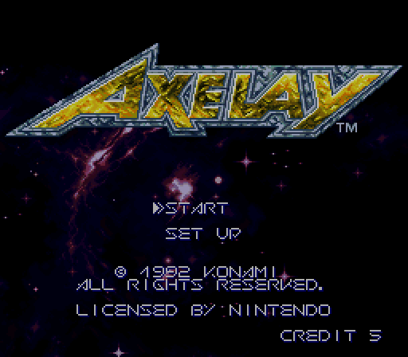
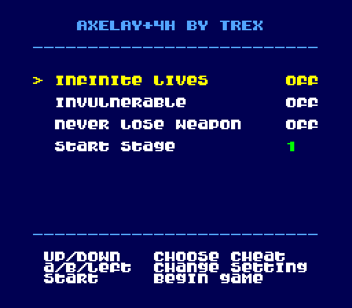
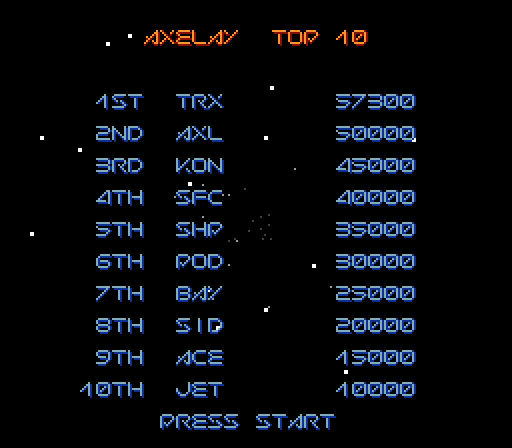

# Axelay (USA) TREX

Apply `Axelay (USA) TREX.ips` to **Axelay (USA)**, CRC32 `F812B533` (1 MiB, no header). Patched ROM CRC32: `0820BB22`.

## At a glance

- **High scores:** Both: a new top 10 table, saved to battery SRAM (the original keeps only one high score, lost at power off).
- **Trainer:** INFINITE LIVES, INVULNERABLE, NEVER LOSE WEAPON, START STAGE (1-6).

## Screenshots

| Title screen | Trainer menu | High score table |
|:-:|:-:|:-:|
|  |  |  |

## High scores: new top 10 table + saver

Axelay originally keeps a single high score that is lost at power off. This patch adds a **top 10 table with initials, saved to battery SRAM**, made to look like part of the original game:

- Axelay's own font, light blue with the same dark blue drop shadow as the game's CONTINUE?/CREDIT text, and an orange title like GAME OVER.
- A starfield of sprites flying towards the screen behind it, to suit the shoot 'em up.
- The game's own record (57300) is the 1st place default, and the HUD's HI score always shows the table's top score.
- Initials entry at game over and before a continue; the table also shows in the attract loop when the title is left idle, taking turns with the demo.
- The game over music carries on under the table.

## FastROM and missed frames

**FastROM: added.** The original is SlowROM (2.68 MHz ROM access); the patched game runs at 3.58 MHz.

Missed (lag) frames, the same scripted play for 8000 frames from the start of each stage, no cheats:

| Stage | Before (SlowROM) | After (FastROM) |
|---|---|---|
| 1 | 407 | 107 |
| 2 | 317 | 92 |
| 3 | 397 | 106 |
| 4 | 270 | 73 |
| 5 | 658 | 264 |
| 6 | 621 | 291 |

## Trainer options

The trainer menu appears at power on. Up/Down picks an option, Left/Right/A/B changes it, START plays. High scores are only saved when every option is off and the game starts from the first stage or area.

| Option | |
|---|---|
| INFINITE LIVES | Lives never go down. |
| INVULNERABLE | Bullets and crashes do no harm. |
| NEVER LOSE WEAPON | A bullet hit doesn't destroy the weapon in use. |
| START STAGE | Start on stage 1-6. |
