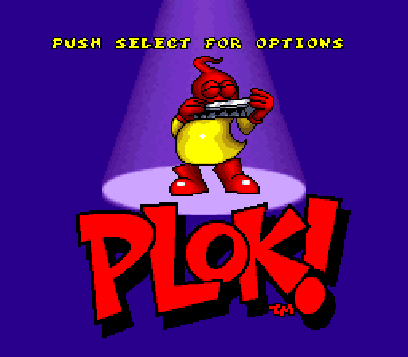
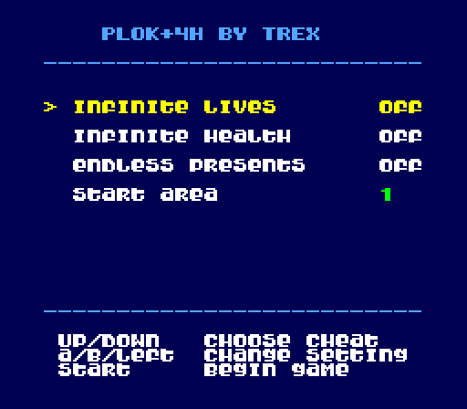
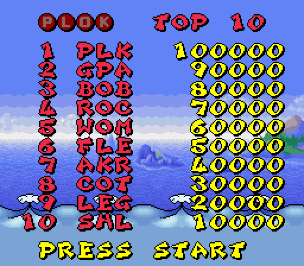

# Plok (USA) TREX

Apply `Plok (USA) TREX.ips` to **Plok (USA)**, CRC32 `BBD678F6` (1 MiB, no header). The patch grows the ROM to 2 MiB. Patched ROM CRC32: `E5CBCF82`.

## At a glance

- **High scores:** Both: a new top 10 table, saved to battery SRAM (the original keeps a score but has no table).
- **Trainer:** INFINITE LIVES, INFINITE HEALTH, ENDLESS PRESENTS, START AREA (1-4).

## Screenshots

| Title screen | Trainer menu | High score table |
|:-:|:-:|:-:|
|  |  |  |

## High scores: new top 10 table + saver

Plok keeps a score but has no table. This patch adds a **top 10 table with initials, saved to battery SRAM**, made to look like part of the original game:

- Plok's own 16x16 font (red names, yellow scores, the new entry in green) and the "PLOK" medallions.
- The Cotton Island sea panorama behind it, with the beach foam waves animating and the sea drifting. It fades in and out.
- Initials entry at game over and after the ending (which now returns to the title instead of looping forever); the table also shows when the title is left idle, with the title music still playing.

## FastROM and missed frames

**FastROM: already in the original.** Plok already runs FastROM code; the patch also moves its data table reads to the fast banks.

Missed (lag) frames, scripted play for 12,000 frames per start area:

| Start area | Before | After |
|---|---|---|
| 1 | 888 | 888 |
| 2 | 700 | 700 |
| 3 | 88 | 88 |
| 4 | 0 | 0 |

Identical, so the patch adds no lag.

## Trainer options

The trainer menu appears at power on. Up/Down picks an option, Left/Right/A/B changes it, START plays. High scores are only saved when every option is off and the game starts from the first stage or area.

| Option | |
|---|---|
| INFINITE LIVES | Lives never go down. |
| INFINITE HEALTH | Hits do no damage (water and pits still kill). |
| ENDLESS PRESENTS | Costumes from presents never time out. |
| START AREA | Start in area 1-4 (Cotton Island, second Cotton Island stretch, Legacy Island, Akrillic). |
